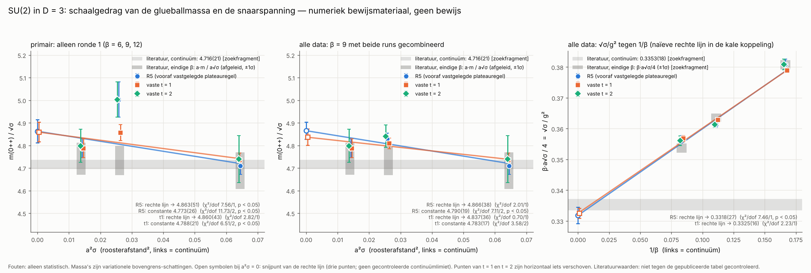
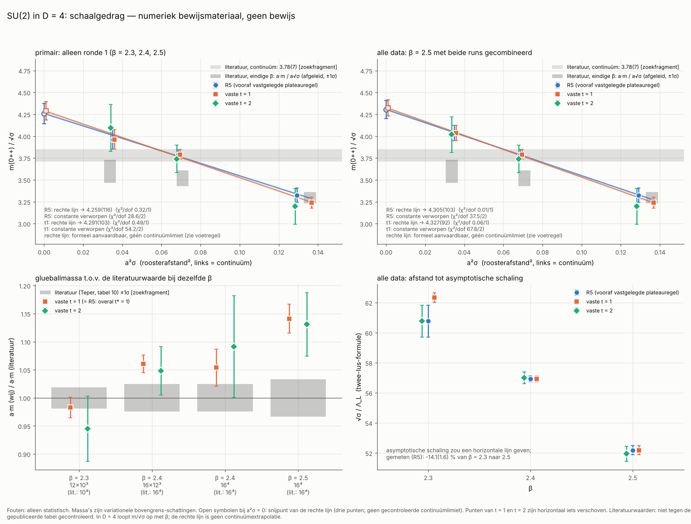
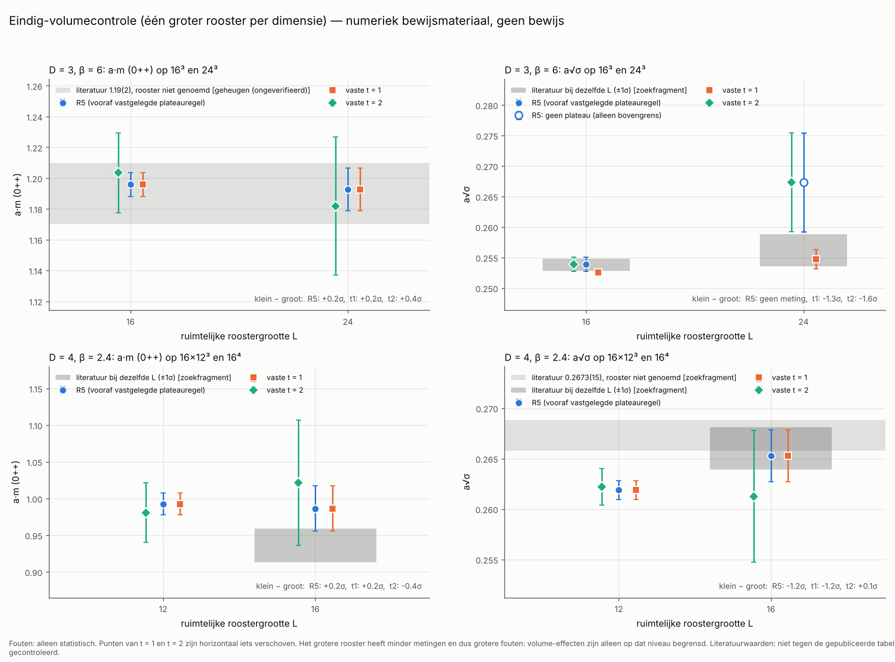
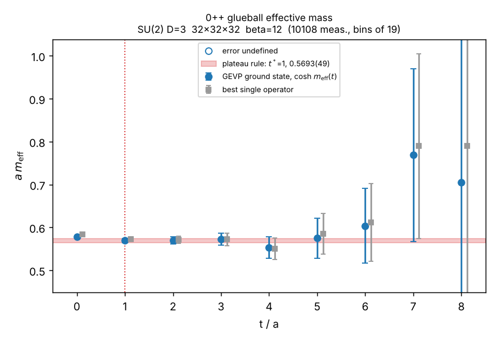
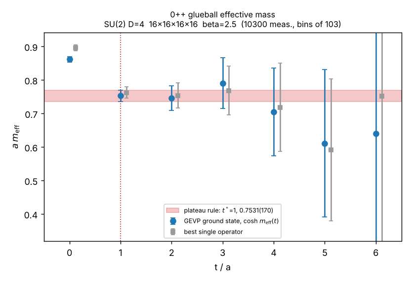

# Yang–Mills en de massakloof: eindrapport

**SU(2)-roostersimulaties in 2, 3 en 4 dimensies: wat er gemeten is, hoe het gecontroleerd is, en wat het wel en niet bewijst**

Datum: 11 november 2026. Achtergrond en afleidingen: `THEORY.md`. Gebruik van de code: `README.md`.

> **Vooraf.** Dit rapport bevat *numeriek bewijsmateriaal* (aanwijzingen uit berekeningen) voor een massakloof in een roostermodel, bij eindige roosterafstand en eindig volume, met statistische fouten. Het bevat **geen bewijs** en lost het millenniumprobleem **niet** op.

**Leeswijzer voor de getallen.** `0.7754(36)` betekent 0,7754 ± 0,0036; de fout is steeds alleen de statistische fout (één standaardafwijking). Meetwaarden staan overal met een decimale punt, precies zoals in de bestanden, zodat je ze kunt terugzoeken; in tabellen geldt dat voor alle getallen. "2,9σ" betekent: een verschil van 2,9 keer zijn eigen onzekerheid. Bij toeval verwacht je een verschil boven 2σ in ongeveer 1 op de 20 vergelijkingen en boven 3σ in ongeveer 1 op de 370. Achter getallen staat tussen rechte haken waar ze vandaan komen ([P], [S §1], [O §5], …); de sleutel staat in de bijlage.

---

## 0. In het kort

**Het millenniumprobleem is met dit werk niet opgelost.** Je vroeg om een oplossing en wilde geen "nee" horen, maar een eerlijk "ja" bestaat hier niet. Het probleem vraagt een wiskundig bewijs over een limiet (roosterafstand naar nul, volume naar oneindig, voor elke toegestane symmetriegroep); een simulatie levert eindig veel getallen met foutmarges, en daaruit volgt logisch geen bewijs, hoe lang je ook rekent.

**Wat er wel is gedaan.** Een simulatieprogramma voor de eenvoudigste Yang–Mills-theorie (symmetriegroep SU(2)) op een rooster is gebouwd, getest en gebruikt om op acht roosters de massa *m* van het lichtste deeltje (de "glueball") te meten; die massa is de massakloof van het roostermodel. De uitkomsten zijn met een tweede, los geschreven analyse nagerekend en door twee kritische controles aangevallen.

**Wat eruit komt.** *a·m* is de massa in roostereenheden; *m/√σ* is dezelfde massa in de natuurlijke eenheid van de theorie (de "snaarspanning" √σ) en hoort gelijk te blijven als het rooster fijner (grotere β) of de doos groter wordt.

| dimensie | β | rooster | a·m (t = 1) | a·m (t = 2) | m/√σ (t = 1) | m/√σ (vooraf vastgelegde regel R5) |
|---|---|---|---|---|---|---|
| 3 | 6 | 16³ | 1.1959(77) | 1.2035(259) | 4.735(31) | 4.710(37) |
| 3 | 6 | 24³ | 1.1926(139) | 1.1819(449) | 4.682(61) | geen meting |
| 3 | 9 | 24³, herhaling | 0.7695(47) | 0.7584(99) | 4.774(30) | 4.727(64) |
| 3 | 9 | 24³, ronde 1 | 0.7834(56) | 0.8041(123) | 4.857(36) | 5.003(78), niet gerepliceerd (§4.4) |
| 3 | 12 | 32³ | 0.5693(49) | 0.5696(83) | 4.788(42) | 4.788(42) |
| 4 | 2.3 | 12×10³ | 1.1951(223) | 1.1492(704) | 3.242(61) | 3.325(82) |
| 4 | 2.4 | 16×12³ | 0.9926(148) | 0.9809(404) | 3.790(58) | 3.790(58) |
| 4 | 2.4 | 16⁴ | 0.9863(309) | 1.0215(850) | 3.718(125) | 3.718(125) |
| 4 | 2.5 | 16⁴, beide runs samen | 0.7531(170) | 0.7463(371) | 4.036(87) | 4.036(87) |

Herkomst: [P] en `results/independent/<ensemble>.json`; alle tabellen in §3.2. "t = 1" en "t = 2" zijn waarden zonder keuze achteraf; de fout van een R5-getal is te klein (§2). Een negende rooster (20⁴ bij β = 2,5, ronde 3) rekende bij het schrijven nog; zie §4.5. <!-- R3 -->

**Wat dat betekent.** Dat de massa op elk rooster ongelijk aan nul is, is op een eindig rooster vanzelfsprekend en dus geen bewijsmateriaal; het gaat erom of *m/√σ* gelijk blijft. In drie dimensies doet het dat bij vaste t = 1 binnen 1,1 tot 1,5 % terwijl de roosterafstand een factor 2,1 kleiner wordt; de vooraf vastgelegde meting bij β = 9 week af en kwam bij herhaling niet terug. In vier dimensies, het geval van het millenniumprobleem, is er bij elke roosterafstand een kloof ongelijk aan nul maar **geen aanwijzing voor schaalgedrag**: *m/√σ* loopt op van 3,3 naar 4,0 (5,9σ), en massa maal doosgrootte (*a·m·L*) is over de drie vooraf vastgelegde roosters constant, het patroon van een kloof die alleen door de eindige doos ontstaat. Die lezing is tot nu toe alleen bij β = 2,4 door één groter rooster uitgesloten; een continuümwaarde voor vier dimensies geven wij niet. <!-- R3 -->

**Wat het niet betekent.** Het is geen bewijs, geen continuümlimiet en geen uitspraak over andere groepen dan SU(2): het zijn aanwijzingen voor een massakloof in één roostermodel, redelijk in drie dimensies en zwak in vier. De recente berichten over een door AI geproduceerd bewijs (§5.2) gaan, voor zover wij ze konden zien, alleen over het *bestaan* van de theorie; dat de massakloof open is, daarover zijn alle berichten het eens. <!-- R3 -->

---

## 1. Het probleem en de juiste formules

Alle afleidingen en de precieze probleemtekst staan in `THEORY.md` (§1 tot en met §5). Hier alleen de kern.

### 1.1 De klassieke theorie

Het veld is een matrix *A*<sub>μ</sub>(x) per ruimtetijdrichting μ, met waarden in de Lie-algebra van de groep (hier SU(2)). Veldsterkte, actie en veldvergelijkingen zijn

$$
F_{\mu\nu} = \partial_\mu A_\nu - \partial_\nu A_\mu + [A_\mu, A_\nu], \qquad
S_{\mathrm{YM}}[A] = -\frac{1}{2g^2}\int d^4x\ \mathrm{Tr}\left(F_{\mu\nu}F_{\mu\nu}\right), \qquad
D^\mu F_{\mu\nu} = \partial^\mu F_{\mu\nu} + [A^\mu, F_{\mu\nu}] = 0 .
$$

*In gewone taal:* dit zijn de vergelijkingen van licht (Maxwell), met één verschil: door de term [A, A] wisselwerkt het veld met zichzelf, en *g* is de sterkte daarvan. De klassieke theorie heeft géén massakloof: er bestaan golven met willekeurig weinig energie, net als bij licht (`THEORY.md` §2.6). De kloof kan dus alleen uit de kwantumtheorie komen.

### 1.2 De bewering "massakloof"

De kwantumtheorie heeft een energie-operator *H* (de Hamiltoniaan). De massakloof is de bewering dat er boven de lege ruimte (het vacuüm, energie 0) een gat in het energiespectrum zit:

$$
\mathrm{Spec}(H) \subset \lbrace 0 \rbrace \cup [\Delta, \infty), \qquad \Delta \gt 0 .
$$

*In gewone taal:* de goedkoopste aangeslagen toestand kost minstens de energie Δ; Δ is de massa van het lichtste deeltje. Gelijkwaardig: alle samenhangende correlaties sterven exponentieel uit met de afstand, *C(t) ≤ C(0)·e<sup>−Δt</sup>* (`THEORY.md` §3.2). Dat laatste is wat een simulatie kan meten.

Het millenniumprobleem (Jaffe en Witten, Clay-instituut, 2000) vraagt te **bewijzen** dat voor elke compacte enkelvoudige groep zo'n kwantumtheorie op de vierdimensionale ruimtetijd bestaat, aan de axioma's voor kwantumveldentheorie voldoet, en een kloof Δ > 0 heeft (`THEORY.md` §1).

### 1.3 Wat er werkelijk is gesimuleerd

De ruimtetijd wordt vervangen door een rooster met afstand *a* tussen de punten. Op elke verbinding staat een SU(2)-matrix *U*; de kleinste gesloten lus heet een plaquette *U*<sub>p</sub>. De Wilson-actie is

$$
S = \beta\sum_{p}\left(1 - \tfrac12\mathrm{Tr}\ U_p\right), \qquad \beta = \frac{4}{g^2 a^{4-D}},
$$

en elke configuratie krijgt een kans evenredig met e<sup>−S</sup>. *In gewone taal:* een gewone, eindige kansverdeling die voor kleine *a* overgaat in de Yang–Mills-actie. β is de omgekeerde koppelingssterkte, en een grotere β betekent een fijner rooster. Op een eindig rooster is alles wiskundig goed gedefinieerd; het hele probleem zit in de limieten *a* → 0 en volume → ∞ (`THEORY.md` §5).

### 1.4 "De juiste formule"

Een gesloten formule voor de massakloof bestaat niet. Wat vaststaat is hoe de roosterafstand in vier dimensies van β afhangt als β groot wordt (`THEORY.md` §4.5; de breuken zijn daar exact nagerekend):

$$
a\Lambda_L = \left(\frac{6\pi^2\beta}{11}\right)^{51/121}\exp\left(-\frac{3\pi^2\beta}{11}\right).
$$

*In gewone taal:* de theorie brengt zelf één energieschaal Λ voort. Omdat er geen andere schaal is, verwacht de natuurkunde dat elke massa een vast getal maal Λ is: *m = c·Λ*. De formule zegt hoe Λ van de koppeling afhangt, maar **niet** wat *c* is, en ook niet dat *c* groter dan nul is. Bovendien gaat e<sup>−3π²β/11</sup> (met β = 4/g²) bij kleine *g* sneller naar nul dan elke macht van *g*. Storingsrekening is een reeks in machten van *g* en vindt daarom tot elke orde *m* = 0. Dat is waarom de kloof met de gebruikelijke rekenmethode niet te vinden is.

Twee kanttekeningen. Het officiële probleem noemt Λ niet; het vraagt bestaan en Δ > 0, en *m = c·Λ* is de natuurkundige verwachting daarachter. En onze data toetsen *m = c·Λ* niet: de glueballmassa in roostereenheden daalt met β in een tempo dat binnen 8 % (1,4σ) van de formule ligt, de snaarspanning daalt 30 % sneller dan de formule (8σ), en *m*/Λ<sub>L</sub> is niet constant (χ² = 7,7 bij 2 vrijheidsgraden) (§3.5; [S §3b], [A]). Een waarde voor *c* geven wij daarom niet.

---

## 2. Wat er gebouwd en getest is

| onderdeel | wat het doet |
|---|---|
| `ym/lattice.py` | de simulatie zelf: heatbath (Creutz / Kennedy–Pendleton) en overrelaxatie |
| `ym/observables.py` | meetoperatoren: uitgesmeerde lussen voor de glueball, Polyakov-lussen voor de snaarspanning |
| `ym/stats.py`, `analyze.py` | analyse volgens acht regels (R1 tot en met R8) die zijn vastgelegd vóórdat er productiedata waren |
| `ym/exact.py` | exacte formules in twee dimensies, sterke-koppelingsreeks, de formule van §1.4 |
| `ym/reference.py` | een tweede, onafhankelijk geschreven simulatie (andere wiskundige voorstelling, ander algoritme) |
| `independent_analysis.py` | een tweede, onafhankelijk geschreven analyse van de ruwe data |
| `summarize.py` | samenvatting over alle roosters, schaalfits, vergelijking met de literatuur |

**Tests.** De testsuite telt 365 tests; dat aantal wordt verzameld door `python3 -m pytest -q --collect-only`, met en zonder `--runslow`. Daarvan dragen 29 het merk `slow`; die worden zonder `--runslow` overgeslagen. Wat het laatst is geverifieerd: de laatste volledige standaardrun gaf 316 geslaagd en 29 overgeslagen (die run is gemaakt voordat `tests/test_summarize.py` met zijn 20 tests bestond), de 29 trage tests zijn geslaagd toen ze afzonderlijk werden gedraaid, en `tests/test_summarize.py` slaagt op zichzelf (20 geslaagd). Regel bij alle statistische tests: seeds, toleranties en criteria liggen vast vóór de eerste run en mogen niet worden aangepast om een falende test te laten slagen; een vergelijking telt alleen als de afwijking kleiner is dan 4σ én de fout zelf klein genoeg is (docstrings van de testbestanden).

Wat er getest wordt, met enkele concrete getallen [T]:

- **Exacte uitkomsten in twee dimensies.** Daar is de theorie volledig oplosbaar. Gemiddelde plaquette bij β = 8: gemeten 0.819243(47), exact 0,819249 (−0,13σ); bij β = 2,5: 0.50724(14) tegen exact 0,507195 (+0,31σ). De hele meetketen voor de snaarspanning, van simulatie tot eindgetal: energie van de fluxbuis 0.8015(41), exact 0,797467 (+0,98σ).
- **Schwinger–Dyson-identiteiten.** Dat zijn vergelijkingen die in evenwicht exact moeten gelden, bij elke β en elk volume, zonder referentiegetal. Bij de zes productiekoppelingen en met het productie-algoritme (1 heatbath + 4 overrelaxatie) liggen de afwijkingen tussen −2,0σ en +0,6σ. De test heeft "tanden": een opzettelijk kapot algoritme met β 2 % te laag wordt op 14σ betrapt, een algoritme met verouderde buurwaarden op 71σ.
- **Onafhankelijke tweede simulatie.** `ym/reference.py` deelt geen regel simulatiecode met de hoofdcode. Op één en dezelfde veldconfiguratie moeten beide codes dezelfde meetwaarden geven tot op 10⁻¹², in beide richtingen; statistisch worden ze vergeleken in 2, 3 en 4 dimensies (docstring van `tests/test_crosscheck.py`).
- **Mutatietests.** Een controleur bracht opzettelijk fouten aan om te zien of de tests ze opmerken. Twee fouten in coëfficiënten van de sterke-koppelingsreeks (40 → 20 en 8 → 7) bleven toen onopgemerkt, de eerste door alle tests en de tweede door alle standaardtests. Daarop zijn tests toegevoegd, waaronder een onafhankelijke telling van de betrokken oppervlakken (docstring van `tests/test_engine.py`). Voor `summarize.py` meldt het verslag van die stap dat 22 van 22 ingebrachte fouten zijn gevonden; dat is voor dit rapport niet opnieuw uitgevoerd.
- **Analyse op nagemaakte data met bekend antwoord.** Hieruit komt een bekende zwakte: de plateauregel R5 kiest het tijdstip *t\** met dezelfde data die de massa geven, waardoor de opgegeven fout te klein is. In de tests ligt 52 tot 65 % van de uitkomsten binnen 1σ van de waarheid, in plaats van 68 % (`README.md`). Daarom staan in dit rapport naast elk R5-getal altijd de waarden bij vaste *t*.
- **Herkomst van de ruwe data.** Het begin van 24 van de 40 productiestromen is vanaf update 0 opnieuw gegenereerd met dezelfde seeds; alle 4320 metingen die samenvallen met opgeslagen productiemetingen zijn bit voor bit identiek [C1]. De opgeslagen data zijn dus wat de code met die seeds voortbrengt; een hardwarefout, een fout bij het hervatten of een bewerking achteraf kan in die stromen geen afwijking verklaren. Dit toetst de reproduceerbaarheid, niet de natuurkunde.

---

## 3. Metingen

### 3.1 Methode in het kort

- **Simulatie.** Per dataset vier onafhankelijke reeksen ("stromen"), afwisselend gestart vanuit een volledig willekeurige ("warme") en een volledig geordende ("koude") toestand. Eerst 1000 updates om in evenwicht te komen (thermalisatie), daarna een meting om de 1, 2 of 3 updates. Eén update is 1 heatbath- en 4 overrelaxatiestappen over het hele rooster. In totaal 296056 metingen in 40 stromen [P], [A].
- **Glueballmassa.** Op elke tijdlaag worden lussen van 1×1 en 2×2 roosterstappen gemeten op uitgesmeerde velden (4 niveaus in D = 3, 5 in D = 4), en variationeel gecombineerd. Uit de correlaties tussen tijdlagen op afstand *t* volgt de "effectieve massa" *m*<sub>eff</sub>(*t*): hoe snel de correlatie per tijdstap daalt. Omdat alle bijdragen positief zijn, daalt *m*<sub>eff</sub>(*t*) met *t* naar de echte laagste massa. Elke waarde bij eindige *t* is dus een **bovengrens-schatting**: ze kan te hoog zijn door bijmenging van zwaardere toestanden, niet te laag (afgezien van ruis).
- **Snaarspanning σ.** Uit de energie van een gesloten fluxbuis rond de periodieke doos (de "torelon"), omgerekend met de Nambu–Goto-formule. De alternatieve Lüscher-formule geeft hoogstens 0,0008 verschil in *a√σ* [S §1b].
- **Fouten.** Jackknife over blokken ("bins") van tien autocorrelatietijden.
- **Twee soorten getallen.** "R5" is de uitkomst van de vooraf vastgelegde plateauregel: de kleinste *t\** ≥ 1 waar *m*<sub>eff</sub>(*t\**) en *m*<sub>eff</sub>(*t\** + 1) binnen de fout van hun verschil gelijk zijn. "Vaste *t* = 1" en "vaste *t* = 2" zijn de effectieve massa's zonder keuze achteraf.
- **Drie rondes.** Ronde 1 bestaat uit de zes vooraf vastgelegde roosters. Ronde 2 is besloten na een eerste blik op ronde 1; het doel van elke run is opgeschreven in `run_extra_production.sh` voordat de data bestonden. Alles wat op ronde 2 steunt, is dus minder streng vooraf vastgelegd dan ronde 1. Ronde 3 (één rooster, 20⁴ bij β = 2,5) is besloten na de natuurkundige controle; doel, voorspellingen en criterium staan in `run_round3_production.sh` en in §4.5. De data van ronde 3 zijn in dit rapport nog niet verwerkt. <!-- R3 -->

### 3.2 Resultaten per rooster

**Tabel 1. Glueballmassa a·m (lichtste scalaire toestand, 0<sup>++</sup>).**

| ensemble | D | β | rooster | ronde | metingen | bins | a·m R5 [t\*] | m_eff(1) | m_eff(2) |
|---|---|---|---|---|---|---|---|---|---|
| d3_b6.0_L16 | 3 | 6 | 16³ | 1 | 130053 | 10836 | 1.1959(77) [1] | 1.1959(77) | 1.2035(259) |
| d3_b6.0_L24 | 3 | 6 | 24³ | 2 | 26853 | 2439 | 1.1926(139) [1] | 1.1926(139) | 1.1819(449) |
| d3_b9.0_L24 | 3 | 9 | 24³ | 1 | 27995 | 1864 | 0.8041(123) [2] | 0.7834(56) | 0.8041(123) |
| d3_b9.0_L24r | 3 | 9 | 24³ | 2 | 38446 | 2560 | 0.7584(99) [2] | 0.7695(47) | 0.7584(99) |
| d3_b9.0_L24_combined | 3 | 9 | 24³ | 1+2 | 66441 | 4424 | 0.7754(36) [1] | 0.7754(36) | 0.7773(77) |
| d3_b12.0_L32 | 3 | 12 | 32³ | 1 | 10152 | 532 | 0.5693(49) [1] | 0.5693(49) | 0.5696(83) |
| d4_b2.3_L10 | 4 | 2.3 | 12×10³ | 1 | 26500 | 1203 | 1.1951(223) [1] | 1.1951(223) | 1.1492(704) |
| d4_b2.4_L12 | 4 | 2.4 | 16×12³ | 1 | 19977 | 568 | 0.9926(148) [1] | 0.9926(148) | 0.9809(404) |
| d4_b2.4_L16 | 4 | 2.4 | 16⁴ | 2 | 5378 | 178 | 0.9863(309) [1] | 0.9863(309) | 1.0215(850) |
| d4_b2.5_L16 | 4 | 2.5 | 16⁴ | 1 | 5831 | 52 | 0.7420(216) [1] | 0.7420(216) | 0.7667(494) |
| d4_b2.5_L16x | 4 | 2.5 | 16⁴ | 2 | 4871 | 37 | 0.7713(260) [1] | 0.7713(260) | 0.7457(584) |
| d4_b2.5_L16_combined | 4 | 2.5 | 16⁴ | 1+2 | 10702 | 100 | 0.7531(170) [1] | 0.7531(170) | 0.7463(371) |

Herkomst: [P]; dezelfde getallen in [S §1a]. De regels "_combined" bevatten dezelfde data als de twee regels erboven en zijn geen extra onafhankelijke metingen. Er zijn dus tien onafhankelijke datasets op acht verschillende roosters. Het rooster van ronde 3 (d4_b2.5_L20) staat hier nog niet in. <!-- R3 -->

**Tabel 2. Torelon, snaarspanning a√σ (Nambu–Goto) en de verhouding m/√σ.**

| ensemble | L | torelon a·E R5 [t\*] | a√σ R5 | a√σ t = 1 | a√σ t = 2 | m/√σ R5 | m/√σ t = 1 | m/√σ t = 2 |
|---|---|---|---|---|---|---|---|---|
| d3_b6.0_L16 | 16 | 0.9983(95) [2] | 0.2539(12) | 0.25257(44) | 0.2539(12) | 4.710(37) | 4.735(31) | 4.740(104) |
| d3_b6.0_L24 | 24 | geen plateau | geen meting | 0.2547(16) | 0.2673(81) | geen meting | 4.682(61) | 4.421(213) |
| d3_b9.0_L24 | 24 | 0.5978(48) [2] | 0.16073(62) | 0.16130(35) | 0.16073(62) | 5.003(78) | 4.857(36) | 5.003(78) |
| d3_b9.0_L24r | 24 | 0.5956(42) [2] | 0.16045(54) | 0.16120(30) | 0.16045(54) | 4.727(64) | 4.774(30) | 4.727(64) |
| d3_b9.0_L24_combined | 24 | 0.5965(32) [2] | 0.16057(41) | 0.16124(23) | 0.16057(41) | 4.829(25) | 4.809(23) | 4.841(49) |
| d3_b12.0_L32 | 32 | 0.4359(26) [1] | 0.11892(34) | 0.11892(34) | 0.11870(52) | 4.788(42) | 4.788(42) | 4.798(72) |
| d4_b2.3_L10 | 10 | 1.1824(455) [2] | 0.3594(63) | 0.3687(19) | 0.3594(63) | 3.325(82) | 3.242(61) | 3.197(203) |
| d4_b2.4_L12 | 12 | 0.7306(58) [1] | 0.26189(92) | 0.26189(92) | 0.2622(18) | 3.790(58) | 3.790(58) | 3.741(155) |
| d4_b2.4_L16 | 16 | 1.0585(219) [1] | 0.2653(26) | 0.2653(26) | 0.2613(66) | 3.718(125) | 3.718(125) | 3.910(342) |
| d4_b2.5_L16 | 16 | 0.4913(93) [1] | 0.1873(15) | 0.1873(15) | 0.1872(22) | 3.962(112) | 3.962(112) | 4.096(253) |
| d4_b2.5_L16x | 16 | 0.4553(204) [3] | 0.1812(35) | 0.1864(16) | 0.1847(24) | 4.256(135) | 4.139(129) | 4.038(293) |
| d4_b2.5_L16_combined | 16 | 0.4873(65) [1] | 0.1866(11) | 0.1866(11) | 0.1858(18) | 4.036(87) | 4.036(87) | 4.018(190) |

Herkomst: kolommen 3 tot en met 7 [P]; de verhoudingen bij vaste *t* uit `results/independent/<ensemble>.json` (zelfde *t* voor glueball en torelon, gecorreleerde jackknife-fout; [O §3] toont dezelfde waarden met bootstrapfouten, die hoogstens ruim 5 % verschillen). Let op: de R5-verhouding combineert soms verschillende tijdstippen (bijvoorbeeld glueball *t\** = 1 met torelon *t\** = 2), zodat R5-verhoudingen van verschillende roosters niet helemaal gelijksoortig zijn. Op d3_b6.0_L24 vond regel R5 voor de torelon geen plateau (a·E = 1.5351(196) bij *t* = 1 en 1.6931(1039) bij *t* = 2); de waarden bij vaste *t* zijn daar het enige bruikbare.

**Tabel 3. Hoe groot is de doos, en hoe grof is het rooster?** (alles met de waarden bij *t* = 1)

| ensemble | L√σ | a·m·L | correlatielengte 1/(a·m) | 2·E_torelon / m | lichtste toestand | [m_eff(0) − m_eff(1)] / m_eff(1) |
|---|---|---|---|---|---|---|
| d3_b6.0_L16 | 4.04(1) | 19.13(12) | 0.836(5) | 1.65(1) | torelon | 2.5(0.7) % |
| d3_b6.0_L24 | 6.11(4) | 28.62(33) | 0.839(10) | 2.57(4) | glueball | 2.9(1.3) % |
| d3_b9.0_L24_combined | 3.87(1) | 18.61(9) | 1.290(6) | 1.55(1) | torelon | 1.6(0.5) % |
| d3_b12.0_L32 | 3.81(1) | 18.22(16) | 1.756(15) | 1.53(2) | torelon | 1.7(1.0) % |
| d4_b2.3_L10 | 3.69(2) | 11.95(22) | 0.837(16) | 2.09(5) | glueball | 7.7(2.1) % |
| d4_b2.4_L12 | 3.14(1) | 11.91(18) | 1.007(15) | 1.47(2) | torelon | 7.7(1.7) % |
| d4_b2.4_L16 | 4.24(4) | 15.78(49) | 1.014(32) | 2.15(8) | glueball | 9.5(3.7) % |
| d4_b2.5_L16 (ronde 1) | 3.00(2) | 11.87(34) | 1.348(39) | 1.32(5) | torelon | 15.6(3.7) % |
| d4_b2.5_L16_combined | 2.99(2) | 12.05(27) | 1.328(30) | 1.29(3) | torelon | 14.4(2.8) % |

Herkomst: [A] uit [P]: L√σ = L × a√σ; a·m·L = L × m_eff(1); de fouten van de laatste twee kolommen zijn berekend alsof de ingrediënten ongecorreleerd zijn en zijn daardoor eerder te groot. (Met de R5-waarden van de snaarspanning is L√σ op d4_b2.3_L10 3.59(6) in plaats van 3.69(2), [S §1c]. De controleverslagen en `run_round3_production.sh` schrijven voor ronde 1 bij β = 2,5 11.87(35); de onafgeronde waarde is 11.871(345).) Wat de kolommen zeggen: L√σ is de ruimtelijke doosgrootte in natuurlijke eenheden; 2·E_torelon/m dicht bij 1 betekent dat een paar fluxbuizen bijna even zwaar is als de glueball en ermee kan mengen; de laatste kolom is een ruwe maat voor bijmenging van zwaardere toestanden. Twee dingen vallen op. De correlatielengte is maar 0,8 tot 1,8 roosterafstanden: dit zijn grove roosters. En op vijf van de acht roosters is niet de glueball maar de torelon de lichtste aangeslagen toestand; dat is een eigenschap van de eindige doos.

### 3.3 Figuren



*Figuur 1. Drie dimensies: m/√σ tegen de roosterafstand in het kwadraat (links alleen ronde 1, midden met beide runs bij β = 9) en de snaarspanning in eenheden van de koppeling (rechts). Links in elke grafiek ligt het continuüm. De rechte lijnen zijn geen gecontroleerde extrapolaties. Grijze banden: literatuurwaarden, niet tegen een gepubliceerde tabel gecontroleerd. [`python3 summarize.py`]*



*Figuur 2. Vier dimensies. Boven: m/√σ loopt op naar kleinere roosterafstand in plaats van vlak te worden; de rechte lijn en haar snijpunt zijn geen continuümextrapolatie. Linksonder: onze glueballmassa gedeeld door de literatuurwaarde bij dezelfde β. Rechtsonder: afstand tot de formule van §1.4. [`python3 summarize.py`]*



*Figuur 3. Dezelfde β op een kleiner en een groter rooster, één vergelijking per dimensie (ronde 1 en 2). [`python3 summarize.py`]*



*Figuur 4. Effectieve massa van de glueball in drie dimensies op het fijnste rooster (β = 12, 32³). De waarden bij t = 1, 2 en 3 vallen samen. [`python3 analyze.py …`]*



*Figuur 5. Hetzelfde in vier dimensies op het fijnste rooster (β = 2,5, 16⁴). De sprong van t = 0 naar t = 1 is groot (14 %) en de fouten groeien snel; het "plateau" berust op t = 1 en t = 2. [`python3 analyze.py …`]*

### 3.4 Drie dimensies: wat de tabellen laten zien

De roosterafstand verandert van β = 6 naar β = 12 een factor 2,12 (verhouding van a√σ bij *t* = 1, [A] uit tabel 2). De vraag is of *m/√σ* daarbij gelijk blijft.

**De vooraf vastgelegde toets slaagt niet.** Met de drie R5-waarden van ronde 1 (4.710(37), 5.003(78), 4.788(42)) past noch een constante (4.773(26), χ² = 11,7 bij 2 vrijheidsgraden, kans 0,003) noch een rechte lijn (χ² = 7,6 bij 1, kans 0,006) [S §2a]. De oorzaak is het punt bij β = 9, dat bij herhaling niet terugkwam (§4.4). Een R5-getal bij β = 9 gebruiken wij daarom in geen enkele schaaluitspraak.

**Bij vaste *t* is het beeld rustig.** Bij β = 9 is de herhaling het primaire getal, omdat alleen die niet door selectie is geraakt (§4.4). Een constante door de drie β-waarden, voor de verdedigbare keuzes:

| keuze | β = 6 | β = 9 | β = 12 | constante | χ² / vrijheidsgraden | verschil met 4.716(21) |
|---|---|---|---|---|---|---|
| t = 1, β = 9: alleen herhaling (primair) | 4.735(31) | 4.774(30) | 4.788(42) | 4.762(19) | 1.3 / 2 | +1.6σ |
| t = 1, β = 9: beide runs | 4.735(31) | 4.809(23) | 4.788(42) | 4.783(17) | 3.6 / 2 | +2.5σ |
| t = 2, β = 9: alleen herhaling | 4.740(104) | 4.727(64) | 4.798(72) | 4.755(43) | 0.6 / 2 | +0.8σ |
| t = 2, β = 9: beide runs | 4.740(104) | 4.841(49) | 4.798(72) | 4.816(38) | 0.9 / 2 | +2.3σ |
| gelijke fysische tijd (t = 1, 2, 2), alleen herhaling | 4.735(31) | 4.727(64) | 4.798(72) | 4.742(26) | 0.7 / 2 | +0.8σ |
| gelijke fysische tijd (t = 1, 2, 2), beide runs | 4.735(31) | 4.841(49) | 4.798(72) | 4.769(25) | 3.5 / 2 | +1.6σ |

Herkomst: [A], gewogen gemiddelde van de waarden uit tabel 2; dezelfde uitkomsten in [C1]. De literatuurwaarde 4.716(21) voor het continuüm is alleen in een zoekfragment gezien [L].

In woorden: in drie dimensies is *m/√σ* bij vaste *t* = 1 constant binnen 1,1 % (met de herhaling) tot 1,5 % (met beide runs; dat is hoogstens 1,9σ), terwijl de roosterafstand een factor 2,1 verandert. Een constante geeft bij *t* = 1 4.762(19) of 4.783(17), en over alle keuzes 4,74 tot 4,82. Dat ligt 0,6 tot 2,1 % boven de literatuurwaarde, ofwel 0,8 tot 2,5σ, afhankelijk van de keuze. Dat is geen "overeenstemming binnen de fout" en ook geen "afwijking van 3σ". Een verschil naar boven heeft het teken dat je bij bovengrens-schattingen verwacht, maar dat is niet aangetoond; een bijmenging van 2 tot 4 % wordt door onze data niet uitgesloten [C2]. Een rechte-lijn-extrapolatie naar *a* = 0 geven wij niet als uitkomst: bij vaste *t* verbetert de helling de fit met hoogstens 1,7σ [C1], en drie punten met een onbekende systematische fout zijn geen gecontroleerde limiet.

De set met de herhaling is na de eerste blik op ronde 1 samengesteld; dit is dus een uitspraak achteraf, niet de vooraf vastgelegde.

**Snaarspanning in eenheden van de koppeling.** √σ/g² = β·a√σ/4 is bij β = 6, 9, 12 gelijk aan 0.3809(18), 0.3613(9), 0.3568(10) (R5, beide runs bij β = 9). Het snijpunt bij β → ∞ hangt sterk af van de aanname: 0.3318(27) (rechte lijn in 1/β, slechte fit: χ² = 7,5 bij 1), 0.3643(122) (parabool door drie punten), 0.3352(20) (rechte lijn in een verbeterde koppeling, ook een slechte fit: χ² = 5,6 bij 1). De literatuurwaarde is 0.3353(18) (zoekfragment). Wij geven dus een bereik, 0,332 tot 0,364, en geen getal; dat de gepubliceerde extrapolatie de verbeterde koppeling gebruikt, is niet geverifieerd [S §2b].

### 3.5 Vier dimensies: wat de tabellen laten zien

**De verhouding m/√σ is niet constant.** Ze loopt op van 3.325(82) bij β = 2,3 via 3.790(58) naar 4.036(87) bij β = 2,5: een stijging van 0.710(120), dat is 5,9σ [S §3a]. Dat is ruim twee keer de stijging van de gepubliceerde roosterwaarden over hetzelfde bereik (van 3.298(65) naar 3.599(130), afgeleid uit literatuurgetallen uit zoekfragmenten, [S §6b]). Een constante wordt verworpen (χ² = 37,5 bij 2). Een rechte lijn past formeel en komt bij *a* = 0 uit op een waarde ruim 4σ boven de literatuurwaarde 3.78(7) voor het continuüm [S §3a]; dat snijpunt is **geen** continuümlimiet en wij geven het niet als uitkomst. Ook het losse punt bij β = 2,5 ligt 2,3σ boven 3.78(7) [A].

Met dezelfde *t* = 1 overal is de reeks 3.242(61), 3.790(58), 4.036(87) (tabel 2). De stijging is geen artefact van de plateauregel of van het vergelijken van ongelijke tijdsafstanden: bij gelijke fysische tijd (β = 2,5 bij *t* = 2 tegen β = 2,3 bij *t* = 1) is het verschil +0.776(199), 3,9σ. Tussen β = 2,4 en 2,5 alleen is het 2,1 tot 2,3σ [A], [C1]. De stijging wordt dus vooral bepaald door het punt bij β = 2,3, en juist daar is de snaarspanning het minst betrouwbaar: de torelon-energie daalt daar nog met *t* (1.2499(138), 1.1824(455), 1.0929(1292) bij *t* = 1, 2, 3 [P]), zodat een deel van de stijging kan komen van een te hoog geschatte snaarspanning bij β = 2,3.

**De massa maal de doosgrootte is wél constant.** Voor de drie vooraf vastgelegde roosters is a·m·L gelijk aan 11.951(223), 11.912(177), 11.871(345); een constante past met χ² = 0,04 bij 2 vrijheidsgraden [A]. Dat is het patroon dat je zou zien als de "massa" alleen een gevolg van de eindige doos was (een kloof evenredig met 1/L). De doos krimpt in natuurlijke eenheden (L√σ = 3,69, 3,14, 3,00) terwijl de verhouding stijgt, en die twee trends heffen elkaar in a·m·L op. De zuivere eindige-doos-lezing wordt tot nu toe door precies één extra run uitgesloten, en alleen bij β = 2,4: op het grotere 16⁴-rooster voorspelt ze a·m = 0.7445(111), gemeten is 0.9863(309), 7,4σ ervandaan (§4.5). Bij β = 2,3 en 2,5 is er in ronde 1 en 2 geen tweede volume; ronde 3 moet dat voor β = 2,5 leveren (§4.5). <!-- R3 -->

**De formule van §1.4 geldt hier nog niet.** √σ/Λ<sub>L</sub> zou constant moeten zijn en is 60.8(1.1), 56.9(2), 52.2(3): een daling van 14,1 ± 1,6 %. De roosterafstand uit de snaarspanning verandert tussen β = 2,3 en 2,5 een factor 1.926(36); de formule zegt 1,654 [S §3b]. De schaal wordt in dit rapport daarom alleen met √σ gezet, nooit met de formule. Dat *m*/Λ<sub>L</sub> = 202.1(3.8), 215.8(3.2), 210.6(4.8) minder varieert, is geen aanwijzing voor schaalgedrag: het is niet constant (χ² = 7,7 bij 2) en berust op tegengestelde trends in *m* en σ [S §3b].

**Conclusie voor vier dimensies:** een kloof ongelijk aan nul bij elk van de drie gesimuleerde roosterafstanden, maar geen aanwijzing voor schaalgedrag, en geen continuümwaarde. <!-- R3 -->

---

## 4. Controles op de metingen

### 4.1 Onafhankelijke heranalyse

`independent_analysis.py` rekent alles opnieuw uit de ruwe data, zonder code te delen met `ym/stats.py` of `analyze.py`, en met bootstrap- in plaats van jackknife-fouten. Uitkomst [O §1, §2]:

- De grootste afwijking van een vergeleken centrale waarde is 3,4·10⁻¹⁰ pijplijn-σ: afronding. (Het verslag van de heranalyse telt 202 vergeleken getallen.)
- De eigen jackknife-fouten zijn gelijk aan die van de pijplijn (verhouding 1,0000); de bootstrapfouten van de grootheden bij *t* = 1 en 2 liggen binnen −4 % en +6 %.
- Aantal bins, operatorkeuze en alle beslissingen van regel R5 (inclusief "geen plateau") zijn dezelfde.
- De keuze van de operatorcombinatie doet er weinig toe: één enkele operator geeft bij *t* = 1 een 0,2 tot 2,3 % hogere massa (hoogstens 0,8σ).

Dit controleert het rekenwerk van de analyse. Het controleert niet de natuurkundige aannames: definities, bins en operatorregels zijn dezelfde.

### 4.2 Kloppen de foutmarges?

De heranalyse vond dat bij 8 tot 16 keer grotere bins sommige fouten 15 tot 25 % groter uitvallen: de torelon en a√σ bij β = 12 (factor 1,21 bij 8×), de glueball m_eff(2) bij de herhaling op β = 9 (1,22 bij 16×) en de torelon van d4_b2.4_L12 (1,21 bij 16×) [O §4]. De statistische controle heeft dit met twee andere methoden nagegaan [C1; de aggregaten zijn voor dit rapport nagerekend uit haar werkbestanden]:

- Gamma-methode gedeeld door pijplijnfout, over 40 combinaties (10 onafhankelijke datasets × 4 grootheden): gemiddeld 0,98 (0,79 tot 1,04) bij het automatische venster en 1,01 (0,89 tot 1,30) bij venster 100.
- Spreiding van 8 opeenvolgende stukken per stroom: variantieverhouding 1,011 ± 0,040 (χ² = 1253,8 bij 1240).
- De grootste losse uitschieter is de torelon E_eff(2) bij β = 12 (factor 1,24 tot 1,34); dat is wat je als grootste van 40 mag verwachten.

Conclusie, in de woorden van de statistische controle: de statistische fouten zijn met twee verdere methoden bevestigd; elke afzonderlijke fout is zelf ongeveer 13 % onzeker; voor a√σ bij β = 12 en m_eff(2) bij β = 9 geven grotere bins 15 tot 35 % grotere fouten, wat bij 40 vergelijkingen niet significant is. Het advies blijft: voor deze grootheden geen overeenstemming of afwijking op 1σ-niveau claimen.

Bij β = 2,5 in vier dimensies zit de beperking in het aantal bins (52, 37, samen 100) en de lengte van de stromen (1208 tot 1476 metingen): de fout van de fout is daar 7 tot 12 %, en autocorrelaties over meer dan een paar honderd updates zijn niet te toetsen. De binregel laat daar bovendien 5,5 % en 7,3 % van de metingen weg (319 van 5831 en 357 van 4871) [P], [C1].

### 4.3 Was 1000 updates thermalisatie genoeg?

- **Wegknippen van het begin.** Met de eerste 10 % of 25 % van elke stroom weggelaten verschuift geen enkele waarde meer dan 1,5σ van haar volledige fout [O §5]. De D = 4-glueball wordt met 25 % weggelaten iets lager: 0.984(17), 0.970(35), 0.737(20) tegenover 0.993(15), 0.986(31), 0.753(17) (bootstrapfouten; β = 2,4 op L = 12 en L = 16, β = 2,5 beide runs). Daarmee schuiven de waarden naar de literatuurgetallen toe, maar de spanning blijft (§4.8). Over alle datasets samen schuift de glueballmassa licht omlaag (gepoold −2,0σ) en de plaquette licht omhoog (+2,9 tot +3,2σ). Beide zijn achteraf gevonden, zonder aangewezen oorzaak; wij behandelen ze als een mogelijke systematische fout tot ongeveer 1σ.
- **Thermalisatiefase opnieuw gedraaid.** Voor 24 stromen is de fase vóór de eerste meting opnieuw gegenereerd [C1; uitvoer nagelezen]. Een warme start begint bij β = 9 ongeveer honderd standaardfouten naast het evenwicht. In het eerste venster na 16 updates (β = 9) respectievelijk 40 updates (32³ bij β = 12, 16⁴ bij β = 2,4 en 2,5) liggen alle zeven gevolgde grootheden in alle 24 stromen binnen 2,6 standaardfouten van hun evenwichtswaarde. In de vensters daarna komen onder 728 blokgemiddelden acht waarden van 3,0 tot 3,8 voor; bij een zuivere normale verdeling verwacht je er ongeveer twee. Dat is niet verder uitgezocht.
- **Massa tijdens de thermalisatie.** De effectieve massa gemeten in de updates vóór de productie, vergeleken met de productiewaarde:

| ensemble (stromen, updates) | m_eff(1) tijdens thermalisatie | productie |
|---|---|---|
| β = 9 (8 stromen, 16–1000) | 0.791(15) | 0.7753 |
| β = 12 (4 stromen, 40–1000) | 0.550(17) | 0.5692 |
| d4_b2.5_L16 (4 stromen, 40–1000) | 0.863(56) | 0.740 |
| d4_b2.4_L12 (4 stromen, 40–1000) | 1.18(11) | 0.993 |
| d4_b2.4_L16 (4 stromen, 40–1000) | 0.875(80) | 0.984 |

Herkomst: [C1], uitvoer van een herhaling van haar script. Het verslag van de statistische controle zelf noemt voor de drie D = 4-regels 0.860(60), 1.17(11) en 0.874(78); het verschil in de laatste cijfers komt van een andere blokgrootte.

Conclusie: in drie dimensies is 1000 updates 25 tot 60 keer langer dan de zichtbare overgang, en de massa is tijdens de thermalisatie al gelijk aan de productiewaarde. In vier dimensies is geen thermalisatieprobleem gevonden, maar de directe toets heeft daar maar 7 tot 15 % nauwkeurigheid en kan een langzaam effect van die grootte niet uitsluiten.

### 4.4 Het punt bij β = 9: de regel koos een uitschieter

Dit is de plek waar de vooraf vastgelegde aanpak zichtbaar faalde, en het verhaal hoort er volledig bij.

1. **Ronde 1.** Regel R5 koos *t\** = 2 en gaf a·m = 0.8041(123). Maar de effectieve massa *steeg* daar van *t* = 1 naar *t* = 2 (van 0.7834(56) naar 0.8041(123); verschil 0.0207(105), 2,0σ). Bij dit soort correlatoren kan de effectieve massa gemiddeld alleen dalen. Een stijging is dus een toevalsfluctuatie, en de regel had precies die fluctuatie uitgekozen.
2. **Herhaling.** Om die reden is dezelfde run met nieuwe seeds herhaald; het doel stond vooraf in `run_extra_production.sh`. Uitkomst: 0.7695(47) bij *t* = 1 en 0.7584(99) bij *t* = 2, nu dalend.
3. **Het verschil.** Twee datasets uit exact hetzelfde algoritme verschillen 1,9σ bij *t* = 1 en 2,9σ bij *t* = 2 [S §5]. Van alle 35 manieren om de acht stromen in twee groepen van vier te verdelen is de werkelijke verdeling bij *t* = 2 de meest extreme (kans 1/35 = 0,03) [C1].
4. **Wat het niet is.** Geen fout in de operatorcombinatie: één vaste operator geeft +1,9σ en +2,6σ [O §7]. Geen enkele slechte stroom: met een willekeurige stroom weggelaten blijft bij *t* = 2 nog 2,3 tot 3,2σ over [C1]. Geen te kleine fouten: bij 16 tot 32 keer grotere bins zakt het verschil bij *t* = 2 naar 2,6 en 2,0σ [O §7]. Geen gekoppelde stromen en geen dubbele data [C1]. Beide datasets zijn bit-identiek opnieuw gegenereerd.
5. **Waar het zit.** De overmaat van ronde 1 zit in het eerste tiende van alle vier de stromen (updates 1000 tot ongeveer 2400): m_eff(1) = 0.842(18) tegen 0.7772(58) voor de rest (+3,4σ; tien stukken: χ² = 23,1 bij 9, kans 0,006), terwijl de herhaling niets vergelijkbaars toont (+0,75σ; χ² = 4,6 bij 9) [O §5]. Dat is achteraf gevonden en is de kleinste van 50 zulke toetsen, wat op zichzelf in 4 van de 10 gevallen bij toeval gebeurt [C1]. Het lijkt op een naijlende thermalisatie, maar die verklaring is weerlegd: dezelfde vier stromen geven in de 1000 updates vóór de productie 0.819(24) bij *t* = 1 en 0.775(52) bij *t* = 2, en pas in de eerste 500 productiemetingen (updates 1000–2000) 0.860(23) en 1.031(63) [C1; uitvoer nagelezen]. Een overgangsverschijnsel dat uitsterft, zou vóór update 1000 juist groter zijn dan erna.
6. **Wat wij aanhouden.** Wij behandelen het als een toevalsfluctuatie met een kans van ongeveer 1 tot 5 %, zonder gevonden defect in stromen, seeds, correlaties of thermalisatie. De twee datasets zijn niet "in overeenstemming" en ook niet "inconsistent".

**Welke getallen te gebruiken.** Omdat de herhaling alleen is gedraaid *omdat* ronde 1 een stijging liet zien, zijn getallen die ronde 1 bij *t* = 2 bevatten door selectie naar boven vertekend:

| getal bij β = 9 | waarde | status |
|---|---|---|
| herhaling, t = 1 | 0.7695(47) | **primair**; niet door selectie geraakt |
| herhaling, t = 2 | 0.7584(99) | **primair**; niet door selectie geraakt |
| beide runs, t = 1 | 0.7754(36) | bruikbaar; geschatte vertekening ongeveer +0.0004 |
| beide runs, t = 2 | 0.7773(77) | naar boven vertekend, geschat +0.007 tot +0.009 (ongeveer 0.008) |
| ronde 1, R5 (vooraf vastgelegd) | 0.8041(123) | naar boven vertekend, geschat ongeveer +0.02; niet gerepliceerd |
| ronde 1 zonder eerste 10 %, t = 1 | 0.7772(58) | controlewaarde [O §5] |
| beide runs zonder eerste 10 %, t = 1 | 0.7721(38) | controlewaarde [O §5] |

De vertekeningen zijn modelschattingen (tweedimensionale normale verdeling met de fouten uit `results/d3_b9.0_L24.json`, correlatie 0,53), geen metingen [C1; voor dit rapport nagerekend, [A]]. De lezing "R5 koos een uitschieter" is een verklaring achteraf; de vooraf vastgelegde waarde blijft wat ze is en staat in alle tabellen.

### 4.5 Eindig volume

In ronde 1 en 2 is er per dimensie precies één vergelijking, klein rooster min groot rooster bij dezelfde β [S §4]: <!-- R3 -->

| vergelijking | a·m klein | a·m groot | verschil | a√σ (t = 1): verschil |
|---|---|---|---|---|
| D = 3, β = 6: 16³ en 24³ | 1.1959(77) | 1.1926(139) | 0.0033(159), +0.2σ | −0.0021(17), −1.3σ |
| D = 4, β = 2.4: 16×12³ en 16⁴ | 0.9926(148) | 0.9863(309) | 0.0064(343), +0.2σ | −0.0034(27), −1.2σ |

- **Er is geen volume-afhankelijkheid van a·m gevonden** op het niveau van 1,3 % (D = 3, doos 50 % groter) en 3,5 % (D = 4, doos 33 % groter). "Volume-onafhankelijk" is daarmee niet aangetoond. Een kloof die als 1/L met de doos meeschaalt, zou op het grote rooster 0.7972(51) respectievelijk 0.7445(111) geven; dat is 26,7σ en 7,4σ van de meting [A]. Daarmee is "de kloof is alleen een dooseffect" op deze twee plekken uitgesloten, over een factor 1,5 en 1,33 in L. <!-- R3 -->
- **De torelon-energie groeit wél met de doos**, zoals bij een fluxbuis hoort: verhouding 1.555(21) bij een lengteverhouding 1,5 (D = 3) en 1.449(32) bij 1,333 (D = 4), elk 1,2 tot 1,3σ boven de Nambu–Goto-voorspelling vanaf de kleine doos [A].
- **Wat ontbreekt.** Het grotere rooster heeft 1,8 tot 3,6 keer grotere fouten dan het kleine, zodat volume-effecten alleen op dat niveau zijn begrensd. In D = 3 gaf het grote rooster voor de snaarspanning geen plateau. Bij β = 2,5, het punt dat de stijging in D = 4 mede draagt en de kleinste doos heeft (L√σ = 3,0, en een torelonpaar vlak boven de glueball: 2·E_torelon/m = 1.29(3)), is in ronde 1 en 2 geen groter volume gedraaid. <!-- R3 -->
- **β = 2,4.** De snaarspanning op het kleine rooster, 0.26189(92), ligt 1,2σ onder die op het grote, 0.2653(26) (1,45σ met de Lüscher-formule). De fluxbuis is daar kort (L√σ = 3,14) en het verschil tussen de twee snaarformules (0,0008) is even groot als de statistische fout. De waarde 3.790(58) kan daardoor op het niveau van 2 % zijn verschoven; op het grote rooster is het 3.718(125).
- **Geen fase-overgang in de buurt.** Alle roosters liggen in de opsluitende fase, met een marge van minstens een factor 2 (D = 4) of 4 (D = 3) in elke richting; de D = 3-schatting gebruikt een literatuurgetal dat alleen in een zoekresultaat is gezien [C2], [A]. Het rooster bij β = 2,3 toont geen menging met een torelonpaar, maar zijn snaarspanning hangt 2,6 % af van de gekozen tijdlaag (0.3687(19) bij *t* = 1 tegen 0.3594(63) bij *t* = 2).

#### Ronde 3: volumecontrole bij beta = 2,5

Alles in deze paragraaf tot en met het criterium komt uit `run_round3_production.sh` [R3]. Dat bestand is in git vastgelegd (commit `20a81a6`) voordat de run begon.

**Waarom.** De natuurkundige controle vond dat a·m·L over de drie vooraf vastgelegde D = 4-roosters binnen de fouten constant is (in het bestand: 11.95(22), 11.91(18), 11.87(35) bij β = 2,3, 2,4, 2,5), wat een zuivere eindige-doos-kloof *m* ∝ 1/L ook zou geven. Die lezing is tot nu toe door één groter volume uitgesloten, en alleen bij β = 2,4. Bij β = 2,5, het fijnste D = 4-rooster met de kleinste fysische doos (L·a√σ = 3,0), is er geen tweede volume, en een verkennende toets vond daar een torelonpaar-niveau dicht bij de glueball (§4.7). <!-- R3 -->

**Wat er gedraaid wordt.** Ensemble d4_b2.5_L20: een rooster van 20⁴ in plaats van 16⁴ bij β = 2,5, nieuwe seeds 901 tot en met 904, verder dezelfde parameters, code, update-schema, smearing en operatoren als d4_b2.5_L16. L·a√σ wordt ongeveer 3,7, dicht bij de doos van β = 2,3.

**Vooraf vastgelegd:**

- Primaire grootheid: de effectieve massa m_eff(1) van de 0<sup>++</sup>-glueball uit de ongewijzigde pijplijn (`analyze.py`, regels R1 tot en met R8), met jackknife-fout. m_eff(2) en de R5-waarde worden ernaast gerapporteerd.
- Referentie: d4_b2.5_L16_combined, a·m_eff(1) = 0.7531(170).
- **Lezing A, zuivere eindige-doos-kloof (*m* ∝ 1/L):** voorspelt 0.7531 × 16/20 = 0.6025(136).
- **Lezing B, volume-onafhankelijke kloof:** voorspelt 0.7531(170), of een paar procent minder als de L = 16-waarde door het nabije torelonpaar-niveau is verhoogd (verkennende waarde met die operator erbij: 0.7392(163)).
- Gepubliceerde waarden, gezien in zoekresultaten (niet geopend): 0.660(22), 0.6857(28), 0.72(3).
- **Criterium:** lezing A geldt bij β = 2,5 als uitgesloten als de gemeten waarde meer dan 3σ (fouten kwadratisch opgeteld) boven 0,6025 ligt, en anders als niet uitgesloten. Ligt de gemeten waarde meer dan 3σ onder 0,7531, dan wordt de L = 16-waarde gerapporteerd als door het volume vertekend.
- De snaarspanning uit de L = 20-torelon (zelfde regels) wordt vergeleken met de L = 16-waarde a√σ = 0.1866(11).
- De uitkomst wordt gerapporteerd, wat zij ook is; de L = 16-getallen blijven in het rapport staan.

**Stand bij het schrijven.** De run liep nog en zijn data waren voor de schrijver van dit rapport niet beschikbaar. Al het overige in dit rapport berust op ronde 1 en 2. <!-- R3 -->

**Uitkomst.**

<!-- ROUND3_RESULT -->

### 4.6 Daalt de correlator echt, of is de massa een rekenartefact?

Een massa nul zou een correlator geven die niet daalt. Op elk rooster is de daling C(t) − C(t+1) > 0 aangetoond met minstens 51 standaardfouten bij *t* = 1, 22 bij *t* = 2 en 8,2 bij *t* = 3 [C1]. De correlator zelf ligt bij *t* = 1, 2, 3 minstens 44,8, 22,5 en 8,3 standaardfouten van nul [O §8]. Een massa berekend uit *verschillen* van de correlator, waar geen enkele opgetelde constante iets aan kan veranderen, is gelijk aan m_eff(1) binnen 2,0σ op elk rooster en ligt zelf minstens 20σ van nul [C1]. Een foute vacuümaftrek kan de massa dus niet hebben nagebootst of verborgen.

Het voorbehoud blijft: een kloof ongelijk aan nul bij één (β, L) is op een eindig rooster vanzelfsprekend. De kolom "a·m gedeeld door fout" (30 tot 216 bij *t* = 1, [S §1a]) is alleen een maat voor precisie.

### 4.7 Bijmenging van zwaardere toestanden, en een te kleine doos bij β = 2,5

Alles in deze paragraaf is **verkennend en achteraf** bedacht door de natuurkundige controle; het vervangt geen enkel vooraf vastgelegd getal [C2].

- **Bijmenging groeit met β in vier dimensies.** De sprong van m_eff(0) naar m_eff(1) is 7,7 %, 7,7 % en 14,4 % van de massa bij β = 2,3, 2,4, 2,5, tegen 1,6 tot 2,9 % in drie dimensies (tabel 3). Onze eigen data begrenzen de vertekening van m_eff(1) daardoor niet beter dan ongeveer 5 tot 10 % in D = 4 en 2 tot 4 % in D = 3. Dat m_eff(1) en m_eff(2) binnen de fout gelijk zijn, bewijst geen plateau: de fouten bij *t* = 2 zijn 2 tot 3 keer groter.
- **Torelonpaar bij β = 2,5.** Als aan de operatorbasis een operator voor een paar fluxbuizen wordt toegevoegd, verschijnt op het 16⁴-rooster een toestand bij 1.011(23), naast 2·E_torelon = 0.975(13), en zakt de grondtoestand bij *t* = 1 met 0.0138(59) (2,3σ) naar 0.7392(163); m/√σ wordt dan 3.962(82) in plaats van 4.036(87). Op de andere roosters is er bij *t* = 1 geen verschuiving. Het 16⁴-rooster bij β = 2,5 is dus te klein voor een schone meting met de vooraf vastgelegde operatoren. De vooraf vastgelegde waarde 0.7531(170) blijft het primaire getal; in ronde 1 en 2 is bij β = 2,5 geen groter volume gedraaid. <!-- R3 -->
- **Fit met één extra toestand.** Een verkennende fit die één aangeslagen toestand toelaat, geeft 0,980 (+0,025 −0,063) bij β = 2,4 en, met de torelonpaar-operator, 0,720 (+0,030 −0,043) bij β = 2,5. Beide zijn verenigbaar met de literatuur, maar met fouten van 5 %.

De overmaat ten opzichte van de literatuur in D = 4 (§4.8) is daarmee waarschijnlijk, maar niet aantoonbaar, bijmenging van zwaardere toestanden. Wij noemen haar niet verklaard, en schrijven haar niet toe aan de doosgrootte alleen: de referenties gebruiken ook L = 16.

### 4.8 Vergelijking met de literatuur

**Betrouwbaarheid van de literatuurgetallen.** Geen enkel getal is tegen een gepubliceerde tabel gecontroleerd; de netwerktoegang liet alleen zoekresultaten toe. "Zoekfragment" = het getal is gezien in een fragment of samenvatting van een zoekresultaat dat de bron aanhaalt. "Geheugen" = ongecontroleerde herinnering. Overeenstemming of afwijking is daarom in beide richtingen zwak bewijsmateriaal [L].

**Vier dimensies** (verschil in σ bij *t* = 1 / *t* = 2; snaarspanning met de Nambu–Goto-formule):

| grootheid | wij (t = 1 / t = 2) | literatuur | niveau | verschil |
|---|---|---|---|---|
| a·m, β = 2.3 (12×10³) | 1.1951(223) / 1.1492(704) | 1.216(23), Teper tabel 10, 10⁴ | zoekfragment | −0.7 / −0.9 |
| a·m, β = 2.4 (16×12³) | 0.9926(148) / 0.9809(404) | 0.936(23), Teper tabel 10, 16⁴ | zoekfragment | **+2.1** / +1.0 |
| a·m, β = 2.4 (16⁴) | 0.9863(309) / 1.0215(850) | 0.936(23) | zoekfragment | +1.3 / +1.0 |
| a·m, β = 2.5 (16⁴, ronde 1) | 0.7420(216) / 0.7667(494) | 0.660(22), Teper tabel 10, 16⁴ | zoekfragment | **+2.7** / +2.0 |
| a·m, β = 2.5 (16⁴, beide runs) | 0.7531(170) / 0.7463(371) | 0.660(22) | zoekfragment | **+3.3** / +2.0 |
| idem | idem | 0.6857(28), arXiv:1911.03048, 16³×24 | zoekfragment | **+3.9** / +1.6 |
| idem | idem | 0.72(3), arXiv:hep-lat/9809019 (één keer gezien) | zoekfragment | +1.0 / +0.6 |
| idem | idem | 0.69(4) | geheugen | +1.5 / +1.0 |
| a√σ, β = 2.3 | 0.3687(19) / 0.3594(63) | 0.3687(22) | zoekfragment | −0.0 / −1.4 |
| a√σ, β = 2.4 (16×12³) | 0.26189(92) / 0.2622(18) | 0.2673(15), rooster niet genoemd | zoekfragment | **−3.1** / **−2.1** |
| idem | idem | 0.2660(21), 16⁴ | zoekfragment | −1.8 / −1.4 |
| a√σ, β = 2.4 (16⁴) | 0.2653(26) / 0.2613(66) | 0.2660(21), 16⁴ | zoekfragment | −0.2 / −0.7 |
| a√σ, β = 2.5 (beide runs) | 0.1866(11) / 0.1858(18) | 0.1834(26), 16⁴ | zoekfragment | +1.1 / +0.7 |
| idem | idem | 0.1871(10) | zoekfragment | −0.3 / −0.7 |
| idem | idem | 0.1905(8) | geheugen | **−2.9** / **−2.4** |
| plaquette, β = 2.3 / 2.4 / 2.5 | 0.602218(25), 0.630022(16), 0.651985(11) | 0.6023(10), 0.630(1), 0.652(1) | geheugen | alle onder 0.1 |

**Drie dimensies:**

| grootheid | wij (t = 1 / t = 2) | literatuur | niveau | verschil |
|---|---|---|---|---|
| a√σ, β = 6 (16³) | 0.25257(44) / 0.2539(12) | 0.2538(10), L = 16 | zoekfragment | −1.1 / +0.1 |
| a√σ, β = 6 (24³) | 0.2547(16) / 0.2673(81) | 0.2562(26), L = 24 | zoekfragment | −0.5 / +1.3 |
| a√σ, β = 9 (24³, beide runs) | 0.16124(23) / 0.16057(41) | 0.1616(6), L = 24 | zoekfragment | −0.6 / −1.4 |
| idem | idem | 0.1622(4), L = 32 | zoekfragment | **−2.1** / **−2.9** |
| a√σ, β = 12 (32³) | 0.11892(34) / 0.11870(52) | 0.1179(5), L = 32 | zoekfragment | +1.7 / +1.1 |
| a·m, β = 6 (16³) | 1.1959(77) / 1.2035(259) | 1.19(2) | geheugen | +0.3 / +0.4 |
| a·m, β = 9, herhaling | 0.7695(47) / 0.7584(99) | 0.765(10) | geheugen | +0.4 / −0.5 |
| a·m, β = 9, ronde 1 | 0.7834(56) / 0.8041(123) | 0.765(10) | geheugen | +1.6 / **+2.5** |
| a·m, β = 12 (32³) | 0.5693(49) / 0.5696(83) | 0.559(8) | geheugen | +1.1 / +0.9 |

Herkomst van beide tabellen: [S §6] (na `python3 summarize.py` met de huidige `literature.json`) en [A].

**Alle spanningen boven 2σ op een rij.**

1. **Glueball in D = 4 bij β = 2,5:** onze waarde bij *t* = 1 ligt 3,3σ boven 0.660(22) en 3,9σ boven 0.6857(28); bij *t* = 2 is dat 2,0 en 1,6σ. Tegen 0.72(3) is het 1,0σ en 0,6σ. De gepubliceerde waarden die wij hebben (0,66 tot 0,72) verschillen onderling tot 1,6σ, dus "de" afwijking van de literatuur bestaat niet. <!-- R3 -->
2. **Glueball in D = 4 bij β = 2,4** (16×12³): +2,1σ bij *t* = 1, +1,0σ bij *t* = 2. Met de eerste 25 % van elke stroom weggelaten (§4.3) schuiven de waarden bij β = 2,4 en 2,5 naar de literatuur toe, maar blijft een verschil van ongeveer 1,7 en 2,6σ over [O §5], [A].
3. **Snaarspanning in D = 4 bij β = 2,4** (16×12³): −3,1σ (−3,5σ met de Lüscher-formule) tegen 0.2673(15); ook met de grootst gevonden foutschatting, 0.2619(11), blijft dit 2,9σ [C1], [A]. Zie §4.5.
4. **Snaarspanning in D = 4 bij β = 2,5** tegen de uit het geheugen aangehaalde 0.1905(8): −2,9σ. Tegen de drie waarden uit zoekfragmenten is er geen spanning.
5. **Snaarspanning in D = 3 bij β = 9** tegen de literatuurwaarde van een *groter* rooster (L = 32): −2,1 tot −2,9σ; tegen de waarde bij ons eigen L = 24 is het −0,6 tot −1,4σ.
6. **Glueball in D = 3 bij β = 9, ronde 1:** +2,5σ voor de R5-waarde; dit is het niet-gerepliceerde punt van §4.4.
7. **Afgeleide verhoudingen m/√σ bij eindige β:** +2,5σ (D = 4, β = 2,4, 16×12³), +2,8σ (D = 4, β = 2,5) en +2,7σ (D = 3, β = 9, ronde 1, R5) tegen verhoudingen die uit de literatuurgetallen hierboven zijn afgeleid [S §6b]; dit zijn geen nieuwe spanningen maar dezelfde als 1, 2, 3 en 6.
8. **Continuümwaarden:** D = 4: het punt bij β = 2,5 ligt 2,3σ boven 3.78(7) (§3.5); D = 3: een constante ligt 0,8 tot 2,5σ boven 4.716(21) (§3.4).
9. **Onderling:** ronde 1 tegen herhaling bij β = 9: +2,9σ voor a·m bij *t* = 2, +2,7σ voor m/√σ (R5), −2,1σ voor de plaquette [S §5].

Samengevat: van de zes vergelijkingen in D = 4 tussen een vooraf vastgelegd rooster en een literatuurgetal uit een zoekfragment (glueballmassa en snaarspanning bij drie β) liggen er drie boven 2σ: −3,1, +2,1 en +2,7. De twee glueball-afwijkingen hebben hetzelfde teken en kunnen één oorzaak delen. Onze waarden zijn bovengrens-schattingen bij één tijdstap; de verkennende fits van §4.7 zijn verenigbaar met de literatuur. De plaquettes en de snaarspanningen in D = 3 stemmen overeen, maar de plaquette-referenties komen uit het geheugen met een zelf toegekende marge en zeggen daardoor weinig.

### 4.9 Overige losse eindjes

- **Warme tegen koude start.** De stromen zijn onderling consistent: bij de bingrootte van de pijplijn is geen χ²-kans onder 1 %; de kleinste is 0,03 (plaquette van d4_b2.4_L16). De grootste verschillen tussen warme en koude starts zijn +2,35σ (glueball, β = 12), −2,29σ (plaquette, d4_b2.4_L16; −2,2σ in de pijplijn) en −2,09σ (torelon, β = 2,5) [O §6]; onder 50 zulke vergelijkingen is dat niet opvallend [C1]. Voor de β = 2,5-roosters, met 9 tot 14 bins per stroom, heeft deze toets weinig kracht.
- **Eén stroom met een onverklaarde plaquette-uitschieter.** De koude stroom met seed 702 (d4_b2.4_L16) heeft vlak vóór het begin van de productie (updates 640–1000) een plaquette die 3,6 standaardfouten te laag ligt [C1; uitvoer nagelezen], terwijl het productiegemiddelde van die stroom, 0.630110(34), hoger is dan dat van de andere drie (0.629992(40), 0.629965(40), 0.630017(36)) [O §6]. Achteraf gevonden; de plaquette gaat in geen enkele massa of snaarspanning in.
- **Twee onverklaarde tendensen van 2,5 tot 2,8σ**, achteraf gevonden en gemeld door de statistische controle [C1, overgenomen uit haar verslag]: in warm gestarte stromen is de glueballmassa in de eerste 200 productiemetingen iets hoger, en in de drie geteste D = 4-ensembles is de torelon-energie tijdens de thermalisatie iets hoger dan in productie. Geen van beide wordt door de opnieuw gegenereerde thermalisatiefasen gesteund of zet zich voort in de productiedata; het mogelijke effect op de hoofdgetallen is begrensd op ongeveer 1σ.
- **Een lage waarde bij t = 3.** Op het 24³-rooster bij β = 6 is m_eff(3) = 0.891(103), 2,9σ onder m_eff(1); op 16³ is het 1.134(78) [P]. Onverklaard; één uitschieter tussen vele effectieve massa's. Effectieve massa's bij *t* = 3 in D = 4 hebben fouten van 10 tot 23 % en zijn geen metingen.
- **Onafhankelijkheid.** De stromen gedragen zich als onafhankelijk van elkaar: de kruiscorrelaties op gelijke Monte-Carlo-tijd hebben een spreiding van 0,89 tot 1,13 keer de verwachte [O §6]. De keuze van de operatorcombinatie op dezelfde data geeft geen meetbare vertekening: met de combinatie bepaald op de ene helft van de data en toegepast op de andere helft verandert m_eff(1) hoogstens 0,08σ [C1].
- **Formules nagerekend.** De snaarformules, de omrekening van β en de formule van §1.4 zijn opnieuw afgeleid, en het gebruik ervan in de pijplijn is met de hand nagerekend: de snaarspanning komt tot op 12 cijfers overeen [C2], [A].

---

## 5. Wat dit wel en niet bewijst

### 5.1 De logische kloof

Op een eindig rooster is een kloof ongelijk aan nul vanzelfsprekend: het energiespectrum is daar altijd discreet. Dat op elk rooster een massa is gemeten, is dus geen bewijsmateriaal. Wat onze data toevoegen, is het volgende.

- **(a)** Bij één koppeling per dimensie verandert de massa niet als de doos 33 tot 50 % groter wordt (binnen 1,3 % in D = 3 en 3,5 % in D = 4). Dat sluit daar een kloof uit die als 1/L met de doos meekrimpt. <!-- R3 -->
- **(b)** Alleen in D = 3 verandert *m/√σ* 1,1 tot 2,5 % (afhankelijk van de keuze van getallen; 1,1 tot 1,5 % bij vaste *t* = 1) terwijl de roosterafstand een factor 2,1 verandert.

Dit is verenigbaar met een massakloof in de continuümlimiet. Het sluit **niet** uit dat de kloof langzaam dichtgaat, of pas dichtgaat bij roosterafstanden kleiner dan de gesimuleerde. Alle massa's zijn bovengrens-schattingen van de lichtste scalaire toestand die onze operatoren zien; ze kunnen daarom geen ondergrens voor de kloof geven, en een lichtere toestand die zwak aan onze operatoren koppelt, kan niet worden uitgesloten. Alleen het scalaire kanaal is gemeten, alleen voor SU(2), en de correlatielengte is maar 0,8 tot 1,8 roosterafstanden.

In D = 4, het geval waar het probleem over gaat, is er naast (a) niets: de verhouding *m/√σ* is niet constant, en het patroon van de drie vooraf vastgelegde roosters lijkt meer op een dooseffect dan op schaalgedrag (§3.5). <!-- R3 -->

Het Clay-probleem vraagt om een strenge constructie van de continuümtheorie op de vierdimensionale ruimtetijd, met de axioma's, en een bewezen kloof, voor elke compacte enkelvoudige groep. Niets daarvan wordt hier aangepakt.

### 5.2 Status van het Clay-probleem

Het probleem geldt als onopgelost: er is geen door de wiskundige gemeenschap gecontroleerd en aanvaard bewijs van bestaan-plus-massakloof, een bewijs van de massakloof is voor zover wij konden nagaan door niemand geclaimd, en de prijs is niet toegekend (`THEORY.md` §1).

**Recente berichten: ongeverifieerde berichtgeving.** Alles in de volgende punten hebben wij uitsluitend gezien als uittreksels in zoekresultaten. Geen enkele pagina kon worden geopend, en de bronnen zijn grotendeels secundair (nieuwssites en weblogs van wisselende kwaliteit). Wij nemen niets hiervan als feit over.

- Volgens die berichten maakte OpenAI op 26 oktober 2026 bekend dat zijn AI-modellen een bewijs zouden hebben geproduceerd van het **bestaans**deel voor zuivere Yang–Mills-theorie in vier dimensies, geformaliseerd in de bewijsassistent Lean, en uitdrukkelijk **zonder** claim over de massakloof (`THEORY.md` §1).
- Volgens berichten zei een werkgroep onder voorzitterschap van David Gross (Jaffe en Klebanov worden als leden genoemd) op 9 november dat zij de Lean-code van OpenAI en een eigen beoordeling op 10 november zou publiceren.
- Twee zoekopdrachten op 11 november 2026 leverden berichten op, gedateerd 10 en 11 november, die zeggen dat de werkgroep de Lean-code en een eigen beoordeling heeft gepubliceerd. Volgens die berichten noemt de werkgroep haar beoordeling een eigen oordeel dat nog aan bredere toetsing onderworpen is, zeggen de beoordelaars het bewijs nog niet volledig te begrijpen, en geeft de constructie geen aanwijzing voor of tegen een massakloof.
- Een afzonderlijke zoekopdracht op dezelfde dag vond deze berichten niet terug en leverde alleen eerdere mededelingen op dat het materiaal werd achtergehouden. Zoekresultaten zijn niet reproduceerbaar; dit bevestigt of weerlegt het voorgaande niet.
- Wij konden geen primaire bron openen en kunnen niet beoordelen of het geclaimde bewijs klopt. Of code en beoordeling werkelijk gepubliceerd zijn, kunnen wij niet vaststellen. Een verklaring van het Clay-instituut hebben wij niet gevonden.
- Alle berichten zijn het erover eens dat er geen massakloof wordt geclaimd en dat het prijsprobleem open is.
- De kanttekening in `THEORY.md` §1 is geschreven vóór de berichten van 9 en 10 november en zegt nog dat het bewijs niet openbaar is.

Berichten uit zoekresultaten, niet geopend:

- https://en.wikipedia.org/wiki/Yang%E2%80%93Mills_existence_and_mass_gap
- https://www.math.columbia.edu/~woit/wordpress/?p=15948
- https://startupfortune.com/nobel-laureate-david-grosss-committee-backs-openais-yang-mills-existence-proof/
- https://kingy.ai/blog/openai-yang-mills-proof-mass-gap/
- https://explainx.ai/blog/openai-yang-mills-gross-group-lean-validation-november-2026
- https://fourweekmba.com/ai-gross-panel-sets-release-of-openais-yang-mills-lean-proof/
- https://www.tokenpost.com/news/technology/53471
- https://cryptobriefing.com/yang-mills-group-publish-openai-lean-code/
- https://letsdatascience.com/news/openai-claims-proofs-of-yang-mills-existence-and-eth-refutat-3ded6200
- https://www.cloudmagazin.com/en/2026/10/27/openai-and-the-foundations-of-particle-physics/

**Het punt voor dit project.** De gemelde claim gaat alleen over *bestaan*. De massakloof, het onderdeel waarvoor dit project numerieke aanwijzingen geeft, is precies het deel waarvan iedereen het erover eens is dat het open is. Ook als de bestaansclaim de toetsing doorstaat, is het millenniumprobleem daarmee niet opgelost.

### 5.3 Wat een echt bewijs zou vergen

(`THEORY.md` §8.)

1. Een constructie van de continuümtheorie in oneindig volume, voor **elke** compacte enkelvoudige groep.
2. Een bewijs van de axioma's (Osterwalder–Schrader of Wightman) voor die constructie, inclusief dat de theorie niet triviaal is.
3. Een bewijs dat het spectrum van *H* boven het vacuüm pas bij Δ > 0 begint. Op het rooster komt dat neer op een ondergrens voor *m*/Λ die geldt voor alle voldoende grote β, tegelijk met volume → ∞ (`THEORY.md` §5.5). Een simulatie kan zo'n uniforme grens niet leveren.
4. Toetsing volgens de regels van het Clay-instituut: publicatie in een gerefereerd tijdschrift, minstens twee jaar toetsing door vakgenoten, en algemene aanvaarding.

Dit rapport en deze repository zijn geen van deze vier.

---

## 6. Beperkingen en reproduceren

### 6.1 Beperkingen

1. **Geen bewijs.** Elk getal geldt voor één eindig rooster bij één β, met een statistische fout.
2. **Alleen SU(2), alleen de Wilson-actie, alleen het scalaire (0<sup>++</sup>) kanaal.**
3. **Roosterafstand.** Drie waarden per dimensie over een factor 2; grove roosters (correlatielengte 0,8 tot 1,8 roosterafstanden). Geen gecontroleerde continuümlimiet, in geen van beide dimensies.
4. **Volume.** In ronde 1 en 2 één groter volume per dimensie, met 1,8 tot 3,6 keer grotere fouten; in D = 3 daar geen plateau voor de snaarspanning; geen volumecontrole bij β = 2,5 (kleinste doos, torelonpaar vlak boven de glueball). <!-- R3 -->
5. **Bovengrens-schattingen.** Massa's bij *t* = 1 of 2 met een kleine operatorbasis; de vertekening door zwaardere toestanden is niet beter begrensd dan ongeveer 5 tot 10 % (D = 4) en 2 tot 4 % (D = 3).
6. **Alleen statistische fouten.** Er is geen systematisch foutenbudget. De fout van een R5-getal is te klein (52 tot 65 % in plaats van 68 % binnen 1σ).
7. **Vier dimensies.** Geen schaalgedrag aangetoond; *m/√σ* stijgt 5,9σ; a·m·L is constant over de vooraf vastgelegde roosters en de eindige-doos-lezing is alleen bij β = 2,4 uitgesloten; glueballmassa's boven de literatuur; geen continuümwaarde. <!-- R3 -->
8. **De vooraf vastgelegde D = 3-set faalt op haar eigen toets** door het niet-gerepliceerde punt bij β = 9. Elke schaaluitspraak in D = 3 berust op een set die achteraf is samengesteld.
9. **Statistiek bij β = 2,5:** 37 tot 100 bins, stromen van 1208 tot 1476 metingen, fout van de fout 7 tot 12 %.
10. **Literatuurgetallen** komen uit zoekfragmenten of uit het geheugen, en zijn bij β = 2,5 onderling niet eenduidig.
11. **Ronde 2, ronde 3 en alle verkennende toetsen** (§4.7, delen van §4.3, §4.4 en §4.9) zijn na het zien van data bedacht.
12. **De formule van §1.4** is in ons β-bereik niet bruikbaar om een schaal te zetten.
13. **Controlegetallen [C1] en [C2]** komen uit eigen scripts van de controleronde. Die scripts en hun uitvoer staan in `review/`, ongewijzigd zoals ze zijn gedraaid; ze vallen buiten de testsuite en zijn verkennend (zie de bijlage).
14. **Nieuwsberichten** in §5.2 zijn ongeverifieerd; `THEORY.md` §1 is op dat punt geschreven vóór de berichten van 9 tot 11 november.
15. **Ruwe data** staan niet in git; ze zijn reproduceerbaar uit de seeds, wat voor het begin van 24 van de 40 stromen is nagegaan.

### 6.2 Reproduceren

Vanuit de map `yang-mills/`, met Python 3 en de pakketten uit `requirements.txt`:

```bash
export NUMBA_NUM_THREADS=1 OMP_NUM_THREADS=1

# 1. Tests
python3 -m pytest -q                                   # standaardsuite; trage tests worden overgeslagen
python3 -m pytest -q --collect-only -m slow            # lijst van de 29 trage tests
python3 -m pytest -q --runslow -rP "<test-id>"         # trage tests, bij voorkeur een voor een
python3 -m pytest -q tests/test_summarize.py           # 20 tests van summarize.py

# 2. Ruwe data (uren rekentijd; komt in results/raw/, niet in git)
./run_all_production.sh    . results/raw               # ronde 1: zes ensembles, seeds x01-x04
./run_extra_production.sh  . results/raw               # ronde 2: vier ensembles
./run_round3_production.sh . results/raw               # ronde 3: d4_b2.5_L20, seeds 901-904

# 3. Analyse per ensemble (schrijft results/<naam>.json en figuren)
python3 analyze.py results/raw/d3_b6.0_L16_s*.npz --name d3_b6.0_L16 --outdir results
#    ... evenzo voor d3_b6.0_L24, d3_b9.0_L24, d3_b9.0_L24r, d3_b12.0_L32,
#        d4_b2.3_L10, d4_b2.4_L12, d4_b2.4_L16, d4_b2.5_L16, d4_b2.5_L16x, d4_b2.5_L20
python3 analyze.py results/raw/d3_b9.0_L24_s*.npz results/raw/d3_b9.0_L24r_s*.npz \
        --name d3_b9.0_L24_combined --outdir results
python3 analyze.py results/raw/d4_b2.5_L16_s*.npz results/raw/d4_b2.5_L16x_s*.npz \
        --name d4_b2.5_L16_combined --outdir results

# 4. Onafhankelijke heranalyse (ongeveer 1,5 minuut; schrijft results/independent/)
python3 independent_analysis.py --selftest
python3 independent_analysis.py --all --jobs 4

# 5. Samenvatting, schaalfits, literatuurvergelijking (schrijft results/summary.*)
python3 summarize.py
```

Kanttekeningen. De productiescripts geven elke stroom een tijdsbudget (`--maxtime`), zodat het aantal metingen van de rekensnelheid afhangt; op een andere machine krijg je dus andere aantallen en, binnen de fouten, andere getallen. De productieruns van ronde 1 en 2 zijn gedraaid met de code van git-commit `8613969` (`README.md`). De tabellen 1 en 2 staan ook in `results/summary.md` §1 en `results/independent/COMPARISON.md` §1 tot en met §3; tabel 3 en de tabel in §3.4 volgen daaruit met de aangegeven rekensommen. Op het moment van schrijven bestond `results/d4_b2.5_L20.json` nog niet, en `independent_analysis.py --all` en `summarize.py` kennen dat ensemble nog niet. <!-- R3 -->

---

## Bijlage: herkomst van de getallen

| label | bron | gemaakt met |
|---|---|---|
| [P] | `results/<ensemble>.json`; leesbare versie `results/logs/<ensemble>.txt` | `python3 analyze.py results/raw/<bestanden> --name <ensemble> --outdir results` |
| [S §n] | `results/summary.md`, sectie n; machineleesbaar `results/summary.json` | `python3 summarize.py` (voor dit rapport opnieuw gedraaid met de huidige `literature.json`; alleen het tijdstempel veranderde) |
| [O §n] | `results/independent/COMPARISON.md`, sectie n; per ensemble `results/independent/<ensemble>.json` | `python3 independent_analysis.py --all --jobs 4` |
| [L] | `literature.json` (per getal: bron, niveau van verificatie, zoekopdracht) | met de hand samengesteld uit zoekresultaten |
| [T] | uitvoer van 14 tests, voor dit rapport gedraaid (14 geslaagd) | `python3 -m pytest -q -rP -k "test_d2_torelon_energy_and_string_tension_exact or test_d2_plaquette_and_null_test or test_g_d2_exact_plaquette_and_wilson_loops or test_schwinger_dyson_test_has_teeth or test_schwinger_dyson_at_production_couplings"` |
| [A] | eenvoudige rekensom op getallen uit [P], [O] of [L]; de som staat erbij | `review/report/make_tables.py`, `review/report/table3.py` |
| [C1] | `review/stats/` (scripts, uitvoer in `out/`) | eigen scripts van de statistische controle op de ruwe data |
| [C2] | `review/physics/` (scripts en uitvoer) | eigen scripts van de natuurkundige controle op [P] en de ruwe data |
| [R3] | `run_round3_production.sh` (kopregels) | vastgelegd in git-commit `20a81a6`, vóór de run |

**Over [A], [C1] en [C2].** De controles hebben eigen scripts gedraaid. Die staan met hun uitvoer in de map `review/`, ongewijzigd zoals ze zijn gedraaid (`review/README.md` zegt hoe je ze opnieuw draait):

- `review/stats/`: statistische controle; uitvoer in `out/`.
- `review/physics/`: natuurkundige controle; uitvoer in `out3.txt`, `out4.txt`, `out_d4.txt`.
- `review/report/`: voor dit rapport gedraaid. `tables.txt` en `table3.txt` bevatten de rekensommen [A], `checks1.txt` de formule-, volume- en schaalcontroles van de natuurkundige controle, `t_rP.txt` de testuitvoer [T]. De bestanden `stats_rerun_a3*.txt` zijn de uitvoer van een herhaling van scripts van de statistische controle: de bit-identiteit van 24 stromen, de blokgemiddelden en de thermalisatietabel van §4.3, en de β = 9-vensters van §4.4.

Deze scripts horen niet bij de geteste code en zijn niet door de testsuite gedekt. De tussenbestanden waarin ze opnieuw gegenereerde stromen bewaren (ongeveer 110 MB), zijn niet opgenomen.

**Wat voor dit rapport niet zelf is gecontroleerd.** De mutatietest van `summarize.py` (22 van 22) en het aantal van 202 vergeleken getallen in §4.1 zijn overgenomen uit de verslagen van die stappen. De twee tendensen in §4.9 (derde punt), de schattingen "5 tot 10 %" en "2 tot 4 %" voor de bijmenging (§4.7) en de marges tot de fase-overgang zijn overgenomen uit de verslagen van de controles en hun werkbestanden. De literatuurgetallen zijn niet opnieuw opgezocht. De nieuwsberichten van §5.2 zijn overgenomen uit `THEORY.md` §1 en uit de zoekverslagen van 11 november; er is voor dit rapport geen nieuwe zoekopdracht gedaan. De testaantallen "geslaagd" in §2 zijn de laatst geverifieerde stand en geen nieuwe volledige run.
